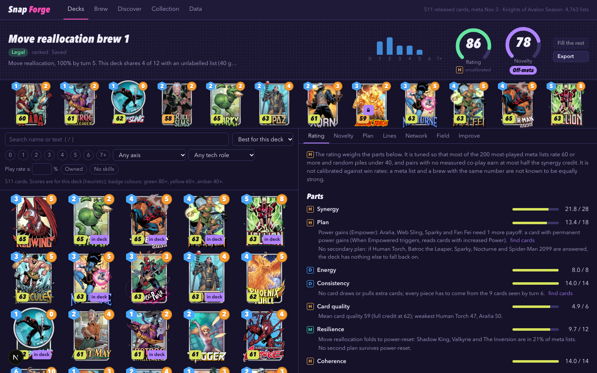
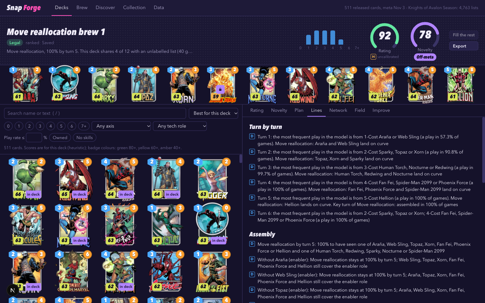
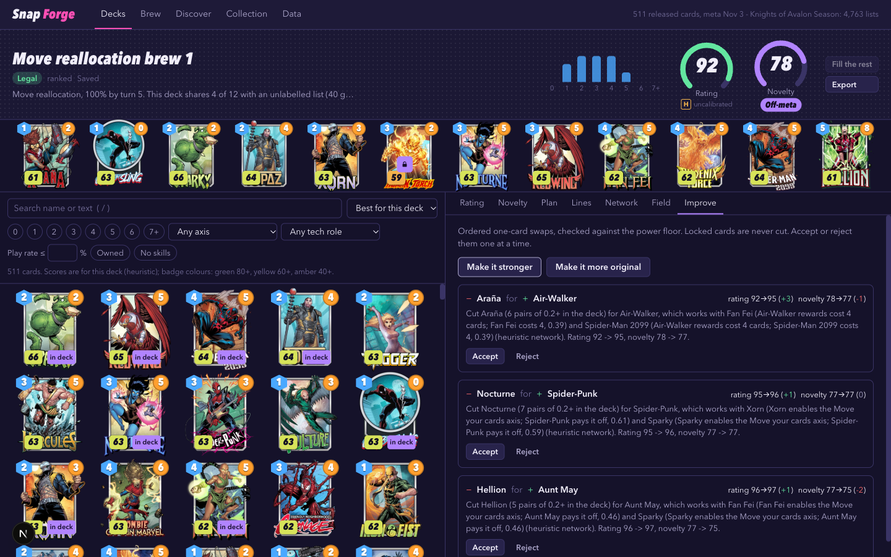

<div align="center">

# Snap Forge

### A creative Marvel Snap deck builder that runs on your own computer

**Brew off-meta Marvel Snap decks that still work, and see why. Mac and Windows.**

[](https://github.com/Egecan33/marvel-snap-deck-builder/releases/latest)
[](https://github.com/Egecan33/marvel-snap-deck-builder/releases)
[](LICENSE)


</div>

Snap Forge is a local deck builder and theorycrafting tool for Marvel Snap whose main goal is creative deck building: it builds decks that function and are measurably different from the known meta lists, and shows why each one should work.

Runs on your own machine. No account, no AI at runtime: every number comes from card text, rules and synced meta lists, and comes with its reasons.

## What it does

- **Brew** around one to four cards, a theme, or a hidden-gem pair ("Surprise me"). Each result is a legal 12-card deck that passed a power floor, with a rating, a separate novelty score, its plan, and a reason per card: the interaction, why it is unusual, what it replaces, the risk.
- **Tuned build**: the same builder with novelty switched off.
- **Build by hand** with live legality, per-card scores (0-100, relative to the deck), a deck rating with sub-scores and fixes, and novelty with its evidence (nearest known lists, rare cards, unexplored pairs).
- **Improve** a pasted list or deck code: ordered one-card swaps ("stronger" or "more original") with rating and novelty deltas, accepted or rejected one at a time. Locked cards are never cut.
- **Theorycraft**: turn 1-6 energy plan with draw odds, plan assembly odds and what each piece is worth, sequencing, location shape, packages, one-card-away plans, the most played archetypes, tech choices, risks.
- **Discover** under-explored pairs and triples: strong interaction, rarely played together. One click brews around them.
- **Collection** import (pasted list or deck codes) plus per-series marking, and an owned-only mode for building.

<table>
<tr>
<td width="50%"><br><sub>Every pick names its interaction and its risk</sub></td>
<td width="50%"><br><sub>Deck rating with sub-scores and fixes</sub></td>
</tr>
<tr>
<td><br><sub>Turn 1-6 energy plan with draw odds</sub></td>
<td><br><sub>Improve: stronger or more original swaps, one at a time</sub></td>
</tr>
<tr>
<td><br><sub>Novelty with its evidence: nearest known lists, rare cards</sub></td>
<td><br><sub>Discover under-explored pairs and triples</sub></td>
</tr>
</table>

## Download

No Node.js or anything else to install. Get the zip for your computer from the [latest release](https://github.com/Egecan33/marvel-snap-deck-builder/releases/latest):

| Computer | File |
|---|---|
| Mac with Apple Silicon (M1 and later) | `SnapForge-<version>-macos-arm64.zip` |
| Mac with Intel | `SnapForge-<version>-macos-x64.zip` |
| Windows 10/11 (x64) | `SnapForge-<version>-windows-x64.zip` |

Unzip it and double-click `Snap Forge.command` (macOS) or `Snap Forge.bat` (Windows). A terminal window opens and the app opens in your browser. Keep the window open while you use it; close it or press Ctrl+C to stop.

- **First run.** The download holds no card data and no card images. The app opens on its **Data** page: press **Sync everything**. It downloads card rows, locations, the current meta lists and about 600 card images, one image per second, so it takes about 10-15 minutes. After that the app works offline. If you stop early, sync again; it fetches only what is missing.
- **macOS** may say the developer is unidentified (the builds are not signed): right-click `Snap Forge.command`, choose **Open**, then **Open** again. Only needed once. Or run `xattr -dr com.apple.quarantine /path/to/the/folder` in Terminal.
- **Windows SmartScreen** may warn you (the builds are not signed): click **More info**, then **Run anyway**.
- Your decks, settings, card data and images live in the `data` folder inside the unzipped folder. To update, download the new zip and move the `data` folder into it.

The app listens on 127.0.0.1 only (port 3230, or the next free one up to 3239).

**What was tested.** The macOS Apple Silicon bundle was unzipped into a fresh folder, started with its starter, synced from its Data page and used to brew decks. The macOS Intel and Windows bundles are built and unit-tested by GitHub Actions only: they were not run on an Intel Mac or a Windows machine. The builds are unsigned.

## Run from source

Needs Node 22 and [pnpm](https://pnpm.io).

```bash
git clone https://github.com/Egecan33/marvel-snap-deck-builder.git
cd marvel-snap-deck-builder
pnpm install
pnpm dev                 # http://localhost:3230
```

The first start opens the **Data** page. Press **Sync everything** (or run `pnpm sync` in a terminal). It downloads card rows, locations, the current meta lists and card art into `data/`, then parses every card and computes the interaction network. Images are fetched one per second, so the first sync takes about ten minutes; later syncs fetch only what is missing. After the sync the app works with the network unplugged.

Then open **Brew**, pick a card nobody builds around, and press **Brew**.

```bash
pnpm sync [cards|locations|meta|features|images|all] [--force]   # meta refuses within 6 h of the last run unless --force
pnpm typecheck && pnpm test     # engine, server and UI unit tests on committed fixtures
pnpm e2e                        # Playwright flows on a copy of your synced database (port 3230 must be free)
pnpm tsx src/ingest/calibrate.ts [Card Name ...]   # brews around off-meta cards and tuned archetype builds, as text
pnpm build && pnpm build:sync && pnpm package     # portable zip for this computer, as the release workflow does
```

## How it works

```
src/engine/    pure TypeScript, no IO: rules, card understanding, interaction network, scoring, rating, novelty, builder, lines
src/ingest/    the sync CLI: cards, locations, meta lists, features, images into SQLite
src/server/    SQLite repositories, analysis context and route handlers
src/app/       Next.js UI
sync-data/     reviewed data files: formats, plan families, card text fixes, card overrides
docs/research  verified research the engine is built on, with sources
packaging/     portable bundles: launcher, starters, assemble script
```

## Measured, derived, heuristic

Every number in the UI carries a tag: **M** measured, **D** derived, **H** heuristic.

- **Measured** (from synced data): play rates and list shares, co-play counts of card pairs, the nearest known lists and how many cards they share, archetype shares of the field, edge-audit precision.
- **Derived** (exact maths over the deck): draw and assembly odds (hypergeometric), the energy model's expected energy spent and no-play odds (a seeded simulation with simple play rules).
- **Heuristic** (rules written for this tool, not calibrated against win rates): card quality, the interaction network's pair scores, plan families, the deck rating and its weights, the power floor thresholds, swap order, matchup and tech advice.

What was measured about the heuristics (fixture of 511 released cards and 300 real meta lists, November 2026; calibration pass 2026-11-13, real database of 4,763 lists in brackets):

| Check | Result | Target in the design |
|---|---|---|
| Parser, hand-read clause audit (125 cards) | 124/125 parser alone, 125/125 with reviewed overrides | 95% |
| Strong interaction edges, held-out hand check (40) | 82.5% strictly true, 100% at least lenient | 85% strict |
| Partner edges (0.4 to 0.5, text-backed), held-out hand check (40) | 85% strictly true, 97.5% at least lenient (after two development rounds that fixed 8 false patterns) | 80% strict |
| Power floor: top-200 meta lists pass | 170 of 200, 85% [181 of 200]; random piles passing: 0 of 50 (1 of 150 in a second set) | 95% / 0% |
| Rating: top-200 meta lists rated 60+ | 181 of 200, 90.5% [185]; random piles under 40: 47 of 50 [47] | 95% / 100% |
| Rating distributions, 10th / 50th / 90th percentile | meta lists 60 / 85 / 92 [67 / 85 / 93]; brews 70 / 80 / 83 [78 / 84 / 88]; random piles 16 / 23 / 36 [18 / 27 / 37] | brews not above the meta median |
| Brew around 20 random off-meta cards | 13 decks, 7 refusals with reasons [real read-out: 6 of 10] | at most 8 refused |
| Results of one build | differ by at least 4 cards (was 1) | 4 |
| Tuned build around the 5 most-played archetype cores | 5 of 5 keep the archetype's plan (was 1 of 5) | 5 |

The rating is a construction check: it says a deck has a plan, a curve, linked cards and answers, not that it wins. Pairs that meta players are measured to play together count fully; pairs only the interaction network sees earn at most half of the synergy credit, so a brew rates below a proven list built as well. The rating is not calibrated against win rates. Novelty is never merged into the rating and never uses measured co-play as evidence of an interaction.

### Known limitations

- Rating and power floor fall short of their design targets (table above), and neither is calibrated against win rates.
- Some off-meta cards are refused for having too few interaction partners (for example Namora, Gilgamesh, Doctor Octopus, Strong Guy); the refusal says why.
- The energy model ignores board space, generated cards and cost cuts from other cards.
- Field advice is generic unless a tech card applies; there is no win-rate matrix.
- About 2% of cards are parsed with a known wrong target.
- Only Ranked deck rules are verified. Other modes are listed as unverified, and decks are never called legal for them.
- The game-state-file collection import was not tested against a real file; the short deck-code format is tested by round trip, not against a code copied from the game.

Full list: [`docs/STATUS.md`](docs/STATUS.md).

## Data sources and caveats

- **Card data, images and meta lists** come from Untapped.gg's public JSON (`docs/research/data-sources.md`, `docs/research/meta-sources.md`). Requests are serial, slow, cookie-free and send a generic user agent. **The site's terms do not allow scraping without written permission and allow personal, non-commercial use only.** This tool is meant to be run that way: by you, on your own machine, with a slow manual sync you start yourself. Card data and images are never committed to this repository or included in the downloads.
- The meta lists are those of tracker users with 20+ games each, which leans to high ranks: a card can be rare there and common elsewhere. With fewer than 300 list clusters, "unexplored" claims are withheld and the UI says why.
- The source's card text drops some dynamic numbers; `sync-data/card-text-fixes.json` restores them from each card's attributes, and a test fails on any new hole.
- Card understanding is a text parser plus a small reviewed overrides file (`sync-data/card-overrides.json`). Card texts change with balance patches: re-sync and check the coverage line on the Data page.
- Marvel Snap Zone is not used (its robots.txt disallows the API).

Project notes: `docs/STATUS.md` (state and known limitations), `docs/HANDOVER.md` (notes per build stage), `docs/superpowers/specs/` and `plans/` (design and plan), `docs/research/` (research with sources and verification logs).

## Contributing

Issues and pull requests are welcome. If you work with a coding agent, point it at [`AGENTS.md`](AGENTS.md) first.

## Disclaimer

Snap Forge is an unofficial fan project. It is not affiliated with, endorsed or sponsored by Marvel or Second Dinner. Marvel Snap, its card names, text and artwork are the property of their owners. Card data and images are downloaded to your machine by the sync step and are not part of this repository or the downloads.

Code is released under the [MIT License](LICENSE).
