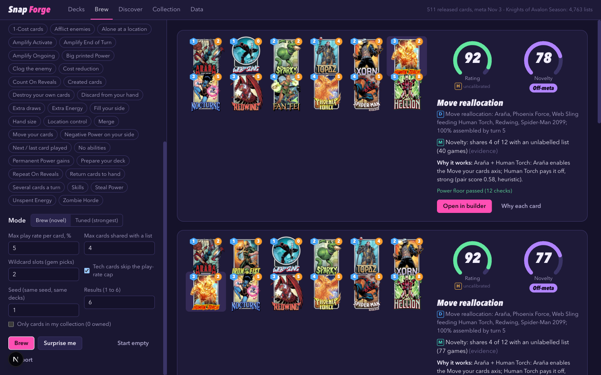
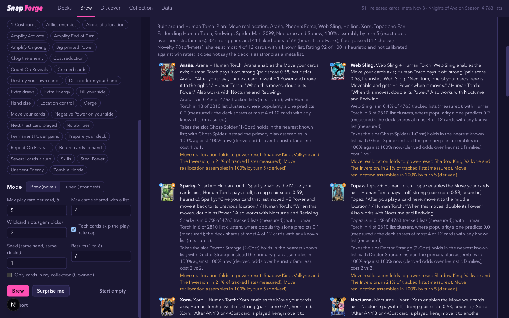
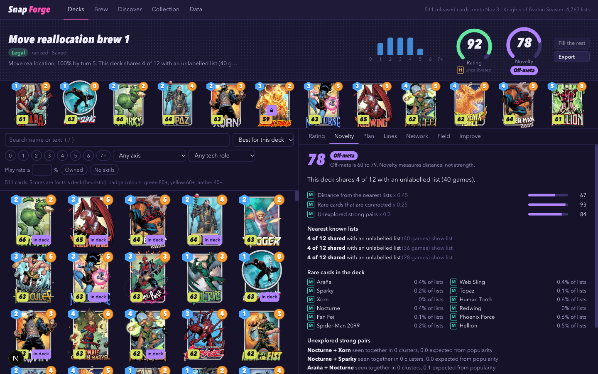
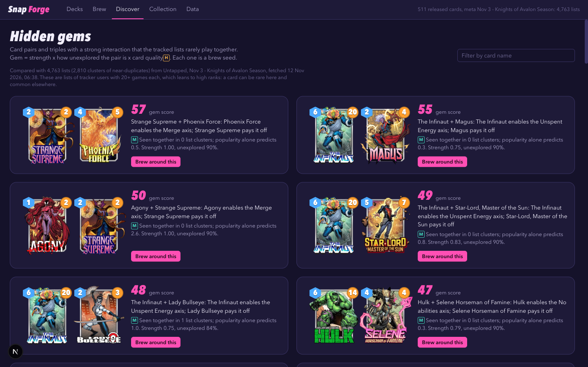

# Snap Forge

A local deck builder and theorycrafting tool for Marvel Snap that pushes creative deck building: it builds decks that function and are measurably different from the known meta lists, and shows why each one should work.

Runs on your own machine. No account, no AI at runtime: every number comes from card text, rules and synced meta lists, and comes with its reasons.



## What it does

- **Brew** around one to four cards, a theme, or a hidden-gem pair ("Surprise me"). Each result is a legal 12-card deck that passed a power floor, with a rating, a separate novelty score, its plan, and a reason per card: the interaction, why it is unusual, what it replaces, the risk.
- **Tuned build**: the same builder with novelty switched off.
- **Build by hand** with live legality, per-card scores (0-100, relative to the deck), a deck rating with sub-scores and fixes, and novelty with its evidence (nearest known lists, rare cards, unexplored pairs).
- **Improve** a pasted list or deck code: ordered one-card swaps ("stronger" or "more original") with rating and novelty deltas, accepted or rejected one at a time. Locked cards are never cut.
- **Theorycraft**: turn 1-6 energy plan with draw odds, plan assembly odds and what each piece is worth, sequencing, location shape, packages, one-card-away plans, the most played archetypes, tech choices, risks.
- **Discover** under-explored pairs and triples: strong interaction, rarely played together. One click brews around them.
- **Collection** import (pasted list or deck codes) plus per-series marking, and an owned-only mode for building.

| | |
|---|---|
|  |  |
|  |  |
|  |  |

## Getting started

Needs Node 22 and pnpm.

```bash
pnpm install
pnpm dev                 # http://localhost:3230
```

The first start opens the **Data** page. Press **Sync everything** (or run `pnpm sync` in a terminal). It downloads card rows, locations, the current meta lists and card art into `data/`, then parses every card and computes the interaction network. Images are fetched one per second, so the first sync takes about ten minutes; later syncs fetch only what is missing. After the sync the app works with the network unplugged.

Then open **Brew**, pick a card nobody builds around, and press **Brew**.

```bash
pnpm sync [cards|locations|meta|features|images|all] [--force]   # meta refuses within 6 h of the last run unless --force
pnpm typecheck && pnpm test     # engine, server and UI unit tests on committed fixtures
pnpm e2e                        # Playwright flows on a copy of your synced database (port 3230 must be free)
pnpm tsx src/ingest/calibrate.ts [Card Name ...]   # brews around off-meta cards and tuned archetype builds, as text
```

## Measured, derived, heuristic

Every number in the UI carries a tag: **M** measured, **D** derived, **H** heuristic.

- **Measured** (from synced data): play rates and list shares, co-play counts of card pairs, the nearest known lists and how many cards they share, archetype shares of the field, edge-audit precision.
- **Derived** (exact maths over the deck): draw and assembly odds (hypergeometric), the energy model's expected energy spent and no-play odds (a seeded simulation with simple play rules).
- **Heuristic** (rules written for this tool, not calibrated against win rates): card quality, the interaction network's pair scores, plan families, the deck rating and its weights, the power floor thresholds, swap order, matchup and tech advice.

What was measured about the heuristics (fixture of 511 released cards and 300 real meta lists, November 2026):

| Check | Result | Target in the design |
|---|---|---|
| Parser, hand-read clause audit (125 cards) | 124/125 parser alone, 125/125 with reviewed overrides | 95% |
| Strong interaction edges, held-out hand check (40) | 82.5% strictly true, 100% at least lenient | 85% strict |
| Rating: top-200 meta lists rated 60+ | 91 of 200 (45.5%); random piles under 40: 41 of 50 | 95% / 100% |
| Power floor: top-200 meta lists pass | 98 of 200 (49%); random piles passing: 0 of 50 | 95% / 0% |
| Brew around 20 random off-meta cards | 10 decks, 10 explicit refusals (too few strong partners) | 12 decks |

The rating is a construction check: it says a deck has a plan, a curve, linked cards and answers, not that it wins. A brew and a meta list with the same rating are not known to be equally strong. Novelty is never merged into the rating. See `docs/STATUS.md` for the known limitations.

## Data sources and caveats

- **Card data, images and meta lists** come from Untapped.gg's public JSON (`docs/research/data-sources.md`, `docs/research/meta-sources.md`). Requests are serial, slow, cookie-free and send a generic user agent. The site's terms do not allow scraping without written permission and allow personal, non-commercial use only; this tool is meant to be run that way, by you, on your own machine. Card data and images are never committed to this repository.
- The meta lists are those of tracker users with 20+ games each, which leans to high ranks: a card can be rare there and common elsewhere. With fewer than 300 list clusters, "unexplored" claims are withheld and the UI says why.
- The source's card text drops some dynamic numbers; `sync-data/card-text-fixes.json` restores them from each card's attributes, and a test fails on any new hole.
- Card understanding is a text parser plus a small reviewed overrides file (`sync-data/card-overrides.json`). Card texts change with balance patches: re-sync and check the coverage line on the Data page.
- Only Ranked rules are verified. Other modes are listed as unverified, and decks are never called legal for them.
- Marvel Snap Zone is not used (its robots.txt disallows the API).

Project notes: `docs/STATUS.md` (state and known limitations), `docs/HANDOVER.md` (notes per build stage), `docs/superpowers/specs/` and `plans/` (design and plan), `docs/research/` (research with sources and verification logs).

## Disclaimer

Snap Forge is an unofficial fan project. It is not affiliated with, endorsed or sponsored by Marvel or Second Dinner. Marvel Snap, its card names, text and artwork are the property of their owners. Card data and images are downloaded to your machine by the sync step and are not part of this repository.
